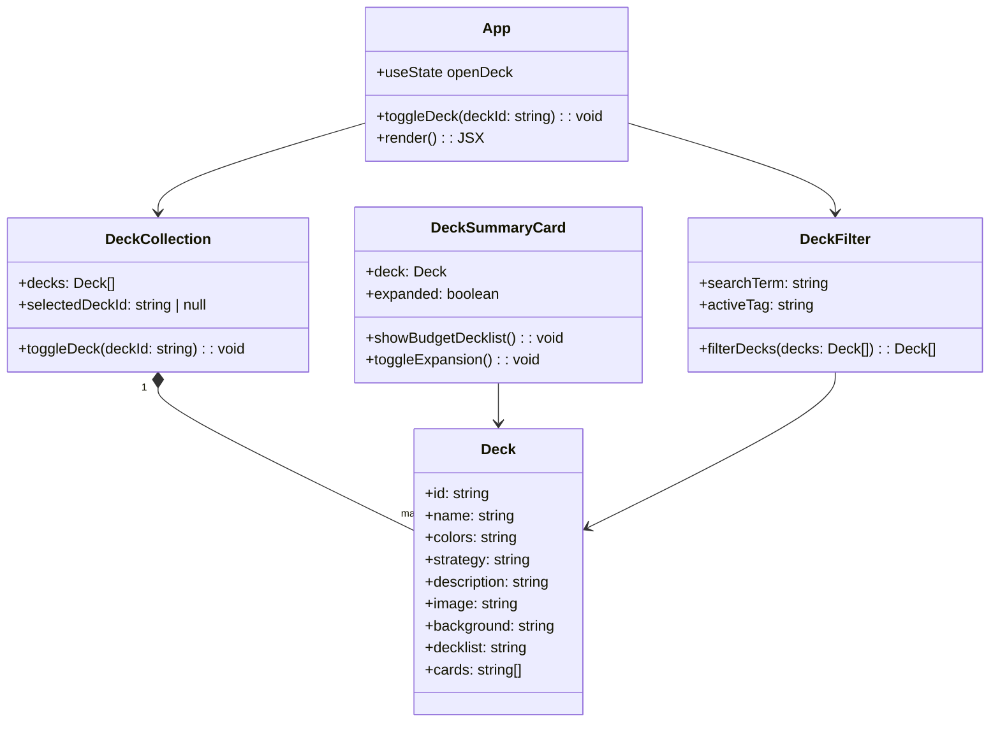

# Class Diagram for MTG Deck Vault

This project models a small Commander deck showcase. The design centers on a deck collection, individual deck records, and the main React view that renders the site.

## Design notes

- `Deck` stores the card data used to render each Commander profile.
- `DeckCollection` groups the deck entries and tracks which one is currently expanded.
- `DeckSummaryCard` is the reusable card layout displayed in the collection.
- `DeckFilter` narrows the list by matching search text and collection tags.
- `App` acts as the page controller and keeps the UI state in sync with the collection.
