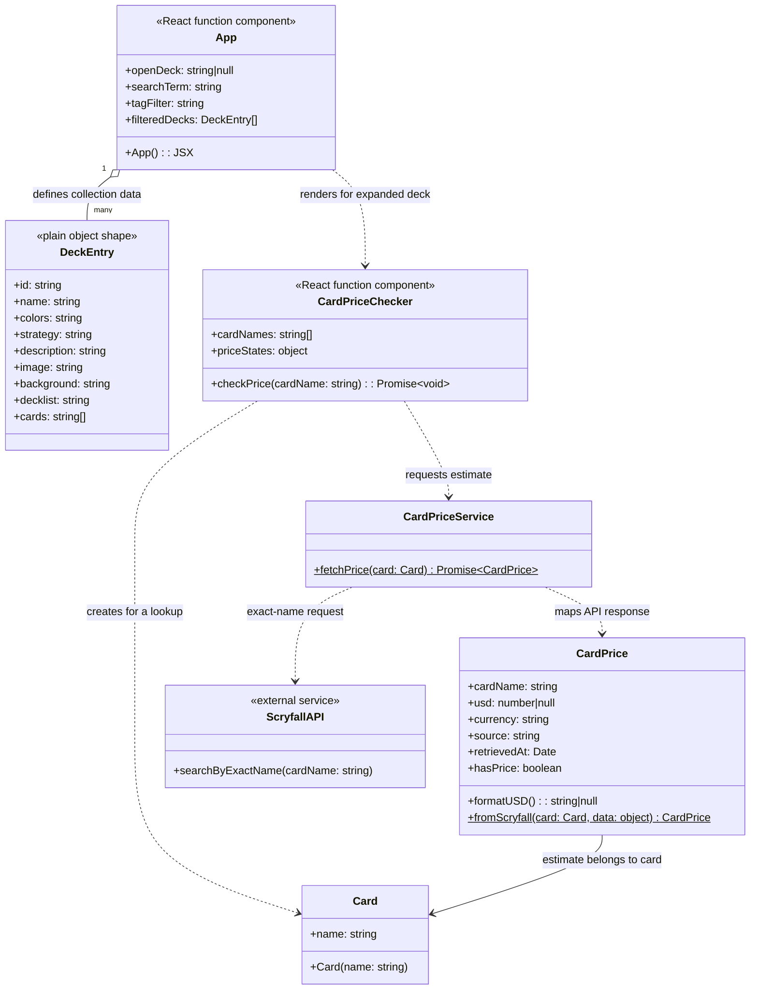

# MTG DeckVault Website Class Diagram

This diagram documents the current website implementation. Deck entries are plain JavaScript objects, while card and price data use classes. React components and the API service are shown with their actual responsibilities.

## How the Website Fits Together

- `App` in `src/App.jsx` owns the deck data and React state for the expanded deck, search text, and color-tag filter. It derives `filteredDecks` from that data.
- Each `DeckEntry` is a plain object in the `decks` array, not a JavaScript class. Its `cards` property contains featured card names only.
- When a deck is expanded, `App` passes its featured names to `CardPriceChecker` in `src/components/CardPriceChecker.jsx`.
- The checker tracks each card's loading, success, or error state. It creates a `Card` from the requested name and asks `CardPriceService` to look it up.
- `CardPriceService` in `src/services/CardPriceService.js` requests an exact-name match from Scryfall. `CardPrice.fromScryfall` in `src/models/CardPrice.js` maps the response into a `CardPrice` model.
- A `CardPrice` may have `usd: null` when no USD listing is available. The site reports individual-card price estimates and does not total the featured cards or claim to price a complete deck.
