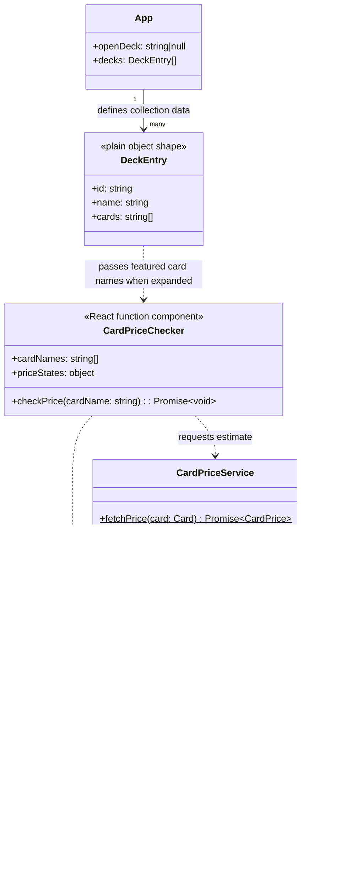

# Card Price Checker Class Diagram

The price checker adds a small model and service layer around the featured card names already stored on each deck entry. It requests a price only after a user selects **Check price** for an individual card.

## How it fits together

- `DeckEntry` describes the existing plain objects in `src/App.jsx`; it is not a new JavaScript class. Its `cards` array remains a list of featured card-name strings.
- `CardPriceChecker` receives those names only when the user expands a deck. It keeps each card's loading, success, or error state locally and asks for prices one card at a time.
- `Card` validates and stores the requested name. `CardPriceService` sends an exact-name request to Scryfall and converts a successful response into `CardPrice`.
- `CardPrice` stores an optional USD estimate and formats it for display. A missing USD listing is represented as `null`, not as a zero price.
- Prices are individual-card estimates for Scryfall's returned printing. The interface does not add them up or present them as a full-deck value.